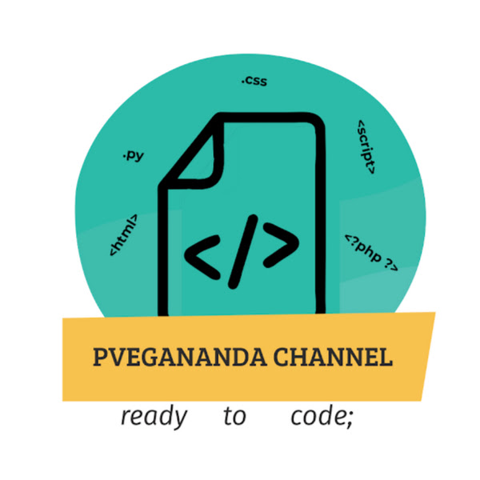

<div align="center">
  

  # PVegananda PHP Web Studio

  **A polished collection of interactive PHP web experiences, practical components, and browser-based demos.**

  <p>
    <a href="https://www.php.net/"></a>
    <a href="https://getbootstrap.com/"></a>
    <a href="https://developer.mozilla.org/en-US/docs/Web/JavaScript"></a>
  </p>
</div>

## About the project

**PVegananda PHP Web Studio** brings together a set of focused web experiences built with PHP, HTML, CSS, JavaScript, and Bootstrap. Each page has a clear purpose, from reusable form handling and PHP concept references to lightweight interactive games.

The project is designed as a concise showcase of practical web development: server-rendered pages, user input, validation, shared layouts, and interactive browser behaviour in one approachable codebase.

## What is included

| Experience | Description |
| --- | --- |
| PHP Concepts | A quick reference for control structures, functions, and arrays. |
| Age Calculator | Calculates an age from a selected date of birth. |
| Knowledge Quiz | A simple scored quiz with server-side result handling. |
| Contact Form | Demonstrates form fields, validation, and submitted data. |
| Snake Game | A browser-based Snake game powered by vanilla JavaScript. |

## Tech stack

- **Backend:** PHP
- **Frontend:** HTML, CSS, Bootstrap 5
- **Interaction:** Vanilla JavaScript
- **Local development:** Apache with XAMPP, WAMP, or Laragon

## Getting started

### 1. Clone the repository

```bash
git clone https://github.com/PVegananda/interactive-php-web-studio.git
cd interactive-php-web-studio
```

### 2. Start a local PHP server

With PHP installed, run:

```bash
php -S localhost:8000
```

Then open [http://localhost:8000](http://localhost:8000) in your browser.

You can also place the project in the document root of XAMPP, WAMP, or Laragon and start Apache.

## Project structure

```text
.
├── age-calculator.php
├── contact-form.php
├── index.php
├── knowledge-quiz.php
├── php-concepts.php
├── snake-game.php
├── welcome.php
├── css/
├── img/
├── js/
└── partials/
```

## License

This project is shared as an open-source portfolio project.

<div align="center">
  <br>
  <strong>Built by <a href="https://github.com/PVegananda">PVegananda</a></strong>
</div>
